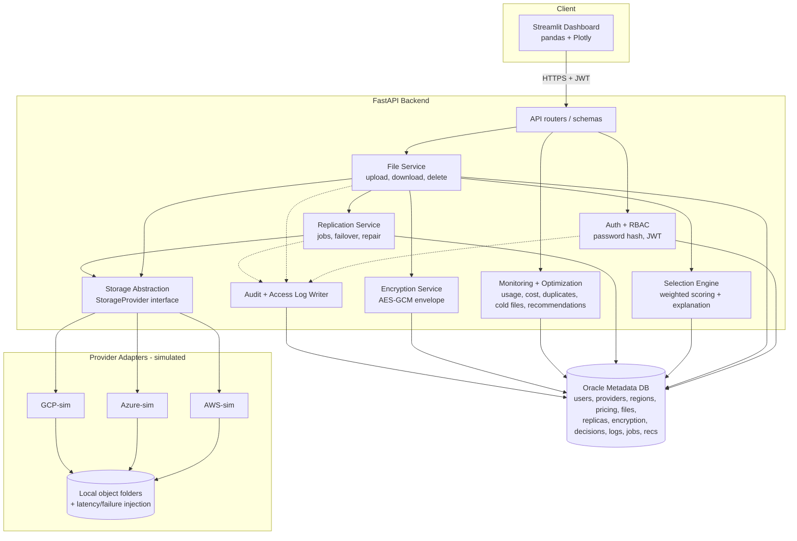
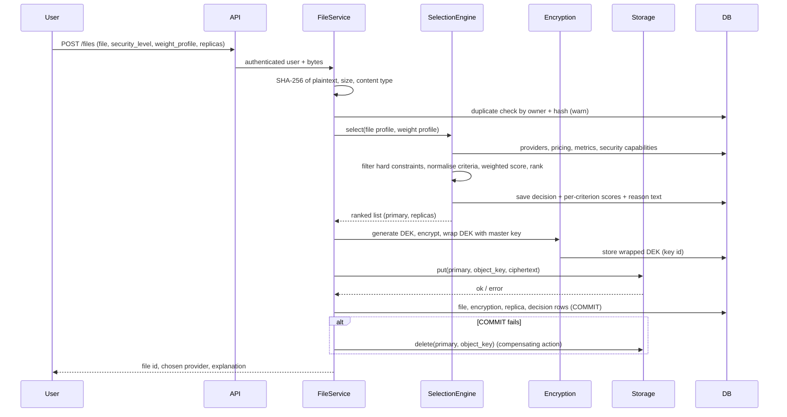
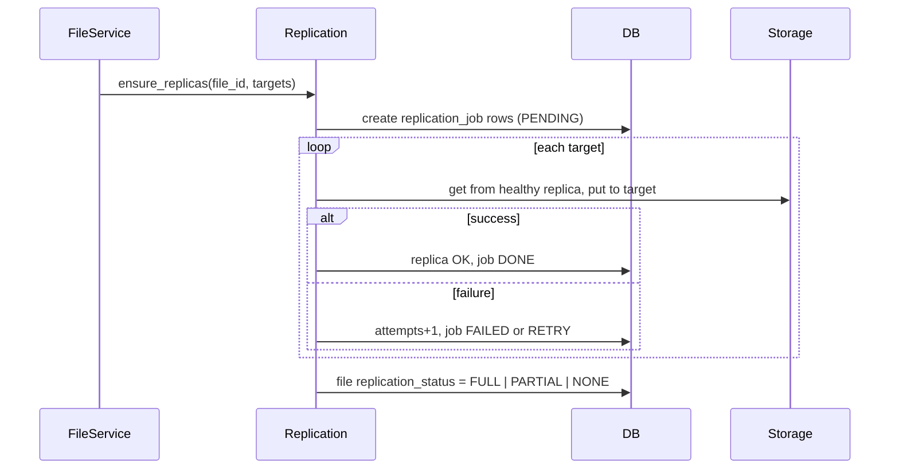

# Multi-Cloud Metadata & Storage Manager: Chunk 0 Design

Status: design only. No application code or SQL. Each later chunk is built and tested against the contracts defined here.

Context found: the repo `ChandhreshAKA/cloud-metadata-management` holds one commit with a single `schema.sql` (users, cloud providers, files, storage locations, access logs, six indexes, one view, transaction examples). I only saw a summary of it. Chunk 1 audits it. It is treated as a starting point, not a constraint.

---

## A. Problem statement

Organisations that store files across several cloud providers (AWS S3, Azure Blob, Google Cloud Storage) end up with these problems:

1. **Fragmented metadata.** Each provider holds its own listing of objects, tags and access records. No single place answers "where is this file, who owns it, how sensitive is it, which copies exist, and who touched it?" Cross-provider questions need ad-hoc scripts.
2. **Hard-to-compare providers.** Storage price, request price, egress price, latency, durability and security features are published in different units, tiers and formats. Comparing them for one specific file is manual and goes stale.
3. **Opaque selection.** Placement is usually fixed by habit ("we use X") or by the cheapest per-GB price. Nobody can say why a file went where it did, and a change in requirements (e.g. file becomes confidential) does not trigger a re-evaluation.
4. **Poor visibility into usage and access.** Teams do not know which files are hot, which are cold, which are duplicated, or what each provider actually costs them. Waste stays hidden.
5. **Access-control weaknesses.** Provider IAM is per account and per provider. There is no single role model, no uniform audit trail, and no read-only auditor role that sees everything but changes nothing.
6. **Provider outages.** A single-provider copy is unavailable when that provider is down. Failover is manual, and nobody records which copies are stale or missing afterwards.
7. **Wasted spend.** Duplicate files, cold data on hot tiers, and over-replicated data all cost money, and nothing flags them from recorded evidence.

**Goal.** Build a centralised, normalised (at least 3NF) Oracle metadata system with an explainable, configurable weighted-scoring selection engine, role-based secure storage with optional replication and failure handling, and a monitoring layer that produces optimisation recommendations from recorded data or documented simulation assumptions.

**Honesty boundary.** Provider calls are simulated behind an adapter interface. The application implements the metadata, logic, encryption and policy. Real cloud configuration is listed separately in section F.

---

## B. Gap table

### B1. General industry limitations (context; not all are solved here)

| Problem | Limitation of conventional approach | Proposed solution | Module | Evaluation metric |
|---|---|---|---|---|
| Vendor lock-in | Data and APIs tied to one provider | Adapter interface plus provider-neutral metadata | M5 | New adapter added without touching the services above it (count of files changed = 0) |
| Provider price opacity | Pricing varies by tier, region and request type | Normalised pricing table, one cost formula | M3 | Same file costed on all providers by one query |
| Real-world network variability | Latency depends on geography and time | Out of scope; modelled by simulation | M5 | Not evaluated (stated limitation) |
| Compliance regimes (GDPR etc.) | Region and legal rules differ | Out of scope; a `region` attribute exists, no legal logic | M3 | Not evaluated |
| Native provider tooling | Vendor consoles show only their own data | Cross-provider catalogue | M1, M10 | Single dashboard spans all providers |

### B2. Gaps specific to this project's scope

| # | Problem | Limitation of conventional approach | Proposed solution | Module | Evaluation metric |
|---|---|---|---|---|---|
| G1 | Fragmented metadata | Per-provider listings, spreadsheets | One relational schema (3NF, FKs, CHECKs) | M1 | 3NF analysis shows no partial or transitive dependencies; every FK enforced |
| G2 | Slow metadata queries | Full scans on growing logs | Indexes on FK and filter columns, `EXPLAIN PLAN` before and after | M1 | Plan cost / access path improves on the 5 benchmark queries |
| G3 | Cheapest-only or random placement | Single criterion, or none | Hard filters (security minimum, size fit, health) then weighted multi-criteria score over storage cost, transfer/request cost, latency, reliability, security | M4 | Placement differs for different file profiles and weight profiles (unit-tested) |
| G4 | Opaque selection | No explanation stored | Persist per-criterion scores and a plain-language reason for every decision | M4 | 100% of uploads have a decision record with all criterion scores |
| G5 | Weak access control | Shared credentials, no auditor role | JWT auth plus USER / ADMIN / AUDITOR RBAC, ownership checks | M2 | Authorisation matrix test: 0 unauthorised actions succeed |
| G6 | Unclear audit trail | Provider logs scattered, mutable | Append-only audit and access logs in the DB | M9 | Every state-changing endpoint produces exactly one audit row |
| G7 | Data exposure | Plaintext at rest | AES-256-GCM envelope encryption before the adapter | M6 | Provider bytes never equal plaintext; tamper test fails decryption |
| G8 | Outage impact | Single copy; manual failover | Replica placement, health-driven failover read, repair job | M8 | Download succeeds with the primary marked down when a replica exists |
| G9 | Duplicate waste | Not detected | SHA-256 content hash, grouped by hash | M11 | Seeded duplicates all found, 0 false positives |
| G10 | Cold data on expensive storage | No visibility | Access-recency and frequency rules produce archive/migrate recommendations with estimated saving | M10, M11 | Each recommendation cites the data (days idle, access count, cost delta) |
| G11 | Silent replication drift | Unknown copy state | Per-replica status and job history | M8 | Dashboard shows OK / PENDING / FAILED / STALE counts that match the DB |
| G12 | Unverifiable claims | "Looks cheaper" with no basis | Assumptions file with every simulated number labelled | M3, M5 | Each simulated figure traceable to `assumptions.md` |

---

## C. High-level architecture



Rules the diagram encodes:

- The UI never touches the DB or providers; it only calls the API.
- Only the File Service orchestrates; selection, encryption, storage and replication are separately testable.
- Only adapters touch bytes at a provider. Only the DB layer runs SQL.
- Encryption happens before bytes reach an adapter. Providers only ever see ciphertext.

---

## D. Workflows

### D1. Register / login
1. `POST /auth/register` with username, email, password. The role defaults to USER; only an ADMIN can grant ADMIN or AUDITOR.
2. Validate input; check username and email are unique.
3. Hash the password (argon2id), insert the user, write an audit row `USER_REGISTERED`.
4. `POST /auth/login` verifies the hash, issues a short-lived JWT (`sub`, `role`, `exp`), writes `LOGIN_OK` or `LOGIN_FAILED`.
5. Repeated failures lock the account temporarily (counter and `locked_until` column).
6. Every protected route runs a dependency that decodes the JWT, loads the user, checks active status, then checks the role.

### D2. Upload and D3. Provider selection


**Selection steps (D3 detail):**
1. **Hard filters.** Drop providers that fail mandatory constraints (HIGH security requires a minimum security score from `system_config`; **size fit: file size must not exceed the provider's `max_object_bytes`**; provider-region currently DOWN or inactive).
2. **Criterion values** per remaining provider for this file: monthly storage cost for its size, request cost, expected transfer cost (from expected access count), p50 latency, reliability (availability and durability score), security score.
3. **Normalise** each of the five scored criteria (storage cost, transfer/request cost, latency, reliability, security) to 0..1 by min-max over the eligible candidates; cost and latency are inverted so higher is better. **Zero range rule:** if `max = min` for a criterion (all candidates equal, or only one candidate), every candidate gets 1.0 for that criterion. A constant added to every candidate cannot change the ranking, equal providers are not penalised, and the explanation states that the criterion did not discriminate. Size fit is *not* a scored criterion.
4. **Weighted sum** using the active weight profile (stored in the DB; weights must sum to 1).
5. **Rank and explain.** The top result is primary. Further ranks supply replica targets (different providers). The stored explanation names the top contributing criteria and the margin over the runner-up.
6. **Deterministic tie-break** (reliability, then provider id). Never random.

### D4. Download
1. `GET /files/{id}`. Authorise: owner, ADMIN, or (metadata only) AUDITOR.
2. Read replica rows ordered by preference, skipping any replica whose provider is DOWN or whose status is not OK.
3. `get()` from the first healthy replica; on error, record the failure and try the next one.
4. Unwrap the DEK, decrypt, verify the GCM tag and the SHA-256 against the stored hash.
5. Write an access log row (user, file, provider used, latency, bytes, success) and return the stream.

### D5. Delete
1. `DELETE /files/{id}`; only the owner or an ADMIN. AUDITOR is refused.
2. Soft delete in a transaction: set status DELETED and the timestamp, mark replicas PENDING_DELETE, write an audit row.
3. Delete the objects at each provider. Failed ones stay PENDING_DELETE and are retried by the repair job.
4. When all replicas are gone, the key is destroyed (crypto-erase) and the metadata row is kept for audit.

### D6. Replication


### D7. Provider failure
1. Health check records an event (`PROVIDER_DOWN`) and sets the provider health state. In the demo this is triggered manually via an admin endpoint or fault injection in the simulated adapter.
2. The selection engine excludes DOWN providers for new uploads.
3. Downloads fail over to the next healthy replica; each failover is logged.
4. Files whose primary is DOWN are flagged DEGRADED; if replicas are missing, a repair job is queued.
5. On `PROVIDER_UP`, the repair job re-copies missing or stale replicas and the status returns to FULL.

### D8. Duplicate detection
1. The SHA-256 is computed on plaintext at upload and stored on the file row (`files.content_sha256`).
2. A scheduled or on-demand scan groups files by hash (`GROUP BY hash HAVING COUNT > 1`), within the same owner or across owners for ADMIN and AUDITOR views.
3. Each group yields a wasted-bytes figure and a monthly waste estimate (extra copies multiplied by their storage price).
4. A recommendation `DEDUPLICATE` is created, naming the keeper and the redundant copies. Nothing is deleted automatically.

### D9. Migration / archival recommendation
1. For each active file, compute days since last access, 30-day access count, current provider and class, and current monthly cost.
2. If a cold-file rule is met (e.g. idle > N days and accesses < M), look up the cheapest suitable archive class that still satisfies the security level.
3. Estimated saving = current monthly cost minus target monthly cost, minus the one-off migration cost (egress plus requests), giving a payback period.
4. Store the recommendation with its evidence (idle days, counts, both cost figures, the assumptions used). It is recommended only if the saving is positive and the payback is under a threshold.
5. An admin reviews it. Approving can trigger the migration through replication (copy, verify, switch primary, delete old).

---

## E. Module output matrix (12 modules)

| # | Module | Inputs | Processing | Outputs | Dependencies | DB tables | Independent output | Integrated output |
|---|---|---|---|---|---|---|---|---|
| M1 | Database & schema | DDL scripts, seed data | 3NF design, constraints, indexes, views, migrations, transaction demos | Created schema, seeded data, view results, `EXPLAIN PLAN` comparisons | Oracle | All | SQL runs on a clean schema; constraint-violation tests; plan comparison | Foundation for all modules |
| M2 | Auth & RBAC | Credentials, JWT, role | Hash and verify, token issue and decode, role and ownership checks, lockout | Tokens, `current_user`, 401/403 responses | M1 | `users`, `roles` | Register, login and authorisation-matrix tests via API | Guards every router |
| M3 | Provider registry & pricing | Provider, class, price and metric data | CRUD, price normalisation, cost calculator (storage + request + egress), metric aggregation | Provider catalogue, `cost_for(file, provider, class)` | M1, M2 | `cloud_providers`, `storage_classes`, `pricing`, `provider_metrics`, `provider_security_features` | Comparison table; cost calculator unit tests | Feeds M4, M10, M11 |
| M4 | Selection engine | File profile, weight profile, provider data | Hard filters, normalise, weighted sum, rank, explain | Ranked providers, scores, reason text | M3 (data only) | `weight_profiles`, `selection_decisions`, `selection_candidates` | Pure-function tests with fixed data; no storage needed | Called by upload (M7) |
| M5 | Storage abstraction & adapters | Object key, bytes, provider id | `StorageProvider` interface; simulated adapters (folder-backed, latency model, fault injection) | `put/get/delete/exists/stat` results, measured latency | None (no DB needed) | none (health state in `cloud_providers`) | Adapter contract tests on each simulated provider | Used by M7, M8 |
| M6 | Encryption service | Plaintext, master key | AES-256-GCM, per-file DEK, DEK wrapping, integrity hash | Ciphertext, wrapped key record, decrypted bytes | M1 (key table), `cryptography` | `encryption_keys` | Round-trip, tamper and wrong-key tests | Wraps every upload and download |
| M7 | File & metadata service | Upload and download requests | Orchestrates M4, M6, M5, M8 and the DB in one transaction, with a compensating delete of the stored object if the commit fails; soft delete | File records, replica rows | M2, M4, M5, M6 | `files`, `file_encryption`, `storage_locations` | Upload, download and delete via API with simulated providers | The core flow |
| M8 | Replication & recovery | File id, targets, provider health | Jobs, retries, failover read, repair after recovery | Replica status, job history | M5, M7 | `replication_jobs`, `provider_events` | Fault-injection tests: down, partial, repair | Called by M7 and the repair job |
| M9 | Audit & access logging | Events from all services | Append-only inserts, structured details | Audit and access history, filterable views | M1, M2 | `audit_log`, `access_logs` | Writer tests; AUDITOR read-only access | Cross-cutting |
| M10 | Monitoring & analytics | Logs, files, pricing, metrics | Aggregation queries and views: usage, access frequency, cost estimate, latency, replication status | KPI dataframes, time series | M1, M3, M9 | Views over existing tables | KPI SQL tested against seeded data | Dashboard data source |
| M11 | Duplicate detection & optimization | Hashes, access stats, cost model | Hash grouping, cold-file rules, migration-saving calculation | Duplicate groups, `recommendations` with evidence | M3, M10 | `recommendations`, `duplicate_scan_runs` | Run against seeded data and check expected output | Shown in dashboard; approval triggers M8 |
| M12 | API & dashboard | HTTP requests, JWT | FastAPI routers and OpenAPI docs; Streamlit pages with pandas and Plotly | Documented endpoints, charts and tables, demo | All | none | Swagger docs and API tests; dashboard with mocked data | End-to-end demo |

---

## F. Technology stack and trade-offs

| Choice | Why | Trade-off / alternative |
|---|---|---|
| **FastAPI** | Typed request models, automatic OpenAPI docs (satisfies the API-docs chunk), dependency injection for auth, easy `TestClient` testing | Async features are barely used (`oracledb` calls are blocking); run sync endpoints in the threadpool. Flask would work but gives no schema docs for free |
| **`oracledb` (thin mode)** | Official driver, no Oracle Client install, connection pooling, bind variables | Oracle-only; smaller community than psycopg |
| **Parameterised SQL (hand-written) instead of SQLAlchemy** | The project is graded on DB concepts. Hand-written joins, views, `EXPLAIN PLAN`, `SAVEPOINT` and index design stay visible and exact; bind variables prevent SQL injection; no ORM-generated SQL to explain | More boilerplate and no automatic migrations; mitigated by a small repository layer with one function per query, and numbered SQL migration files. SQLAlchemy Core would lower boilerplate but hides the SQL and Oracle-specific behaviour (identity columns, `FETCH FIRST`), and adds a dependency without helping the learning objectives |
| **Streamlit** | Fast to build a data dashboard, native pandas/Plotly support | No fine-grained session security; the dashboard is a client of the API only and stores the JWT in session state. A React front end would be heavier for no grading benefit |
| **pandas** | Aggregation and tabular transforms for KPIs and recommendations | Not for heavy work; SQL does the aggregation first |
| **Plotly** | Interactive charts, works in Streamlit | Larger payload than matplotlib |
| **`cryptography`** | Audited, AES-GCM and Fernet primitives | Must be used correctly (nonce handling, key wrapping); wrapped in one small module |
| **Password hashing: argon2-cffi (argon2id)** | Memory-hard, current recommendation | bcrypt is the fallback if wheels are unavailable; never SHA or MD5 |
| **JWT: PyJWT, HS256, short expiry** | Stateless and simple, easy RBAC claims | No server-side revocation by default; mitigated by short expiry plus an active-user check and a `token_version` column if needed |
| **pytest** | Fixtures for DB and adapters, parametrised authorisation matrix | Needs a test schema or a transaction rollback per test |
| **Ruff** | One tool for lint and format, fast | Style only; does not replace type checks (optional `mypy` later) |
| **Docker for Oracle** | Reproducible local DB | Large image; the user may already have Oracle XE (see questions) |

### Simulated vs possibly real

| Area | In this project (implemented) | Simulated | Needs real cloud configuration |
|---|---|---|---|
| Metadata, schema, SQL | Fully real (Oracle) | none | none |
| Auth, RBAC, audit | Fully real | none | Federation with a real IdP (SSO) |
| Selection engine | Real algorithm over stored data | Provider prices, latency and reliability figures are assumed values in the seed data | Live pricing APIs and real measured latency |
| Storage | Interface and adapter contract | Folder-backed "buckets" with injected latency, failures, size limits | Real S3 / Blob / GCS adapters (`boto3`, `azure-storage-blob`, `google-cloud-storage`), credentials, buckets, regions |
| Encryption at rest | Real AES-256-GCM, envelope keys | Master key from an environment variable (stands in for KMS) | AWS KMS / Azure Key Vault / Cloud KMS, key rotation, HSM |
| Encryption in transit | Optional TLS on uvicorn with a self-signed cert | Local TLS only | Managed certificates, TLS enforced at provider endpoints, private networking |
| Replication & failure | Real job logic and state machine | Outages produced by fault injection | Provider-native replication, health probes, DNS failover |
| Cost model | Real formulas | Illustrative price points, flagged in `assumptions.md` | Billing exports from each provider |
| Durability/availability SLAs | Stored as numbers | Illustrative | Contractual SLAs |

---

## G. Requirements

### Functional
- **FR-1** Register and log in; passwords stored only as hashes; JWT with expiry.
- **FR-2** Roles USER, ADMIN and AUDITOR. USER manages own files. ADMIN manages users, providers, weights and recommendations. AUDITOR has read-only access to metadata, audit and access logs, and cannot download content or change anything.
- **FR-3** Maintain providers, storage classes, pricing and metrics (ADMIN).
- **FR-4** Upload a file with security level, access expectation and weight profile; the system selects a provider and returns the explanation.
- **FR-5** The selection uses configurable weights (storage cost, transfer/request cost, latency, reliability, security; weights sum to 1), enforces hard constraints (security minimum, size fit, health), is deterministic, and stores per-criterion scores.
- **FR-6** Download with decryption and integrity verification; failover to a replica.
- **FR-7** Soft delete with key destruction. File versioning is out of scope (a replacement is a new file).
- **FR-8** Optional replication to N further providers; per-replica status; repair.
- **FR-9** Encrypt all content before it leaves the service.
- **FR-10** Log every authentication event, state change and file access.
- **FR-11** Duplicate detection by SHA-256.
- **FR-12** Cold-file detection and archive/migration recommendations with evidence.
- **FR-13** Dashboard: usage, access frequency, estimated cost, provider latency, replication status, recommendations.
- **FR-14** Documented API (OpenAPI) and a scripted end-to-end demo.
- **FR-15** Rollback support: explicit transactions and savepoints for multi-step operations; failed uploads leave no orphan metadata.

### Non-functional
- **NFR-1 Data integrity:** schema in at least 3NF, with PK, FK, UNIQUE, NOT NULL and CHECK constraints.
- **NFR-2 Security:** parameterised SQL only; no secrets in the repo (`.env`, example file committed); constant-time hash comparison; lockout; input validation; least privilege per role.
- **NFR-3 Performance:** indexes on FK and filter columns; common queries show an improved plan; paginated lists.
- **NFR-4 Reliability:** upload is atomic with respect to metadata; recoverable after partial failure.
- **NFR-5 Explainability:** every placement and recommendation is reproducible from stored inputs.
- **NFR-6 Testability:** every module has tests runnable without the others (fakes or seeded data); target coverage stated in chunk 8.
- **NFR-7 Maintainability:** layered modules, Ruff-clean, typed signatures.
- **NFR-8 Portability:** a single `.env`-driven config; runs on Windows.
- **NFR-9 Honesty:** simulated figures documented and visibly labelled in the UI.
- **NFR-10 Scale:** designed for demo scale (thousands of files); no claim beyond that.

---

## H. Folder structure

```
dbmsproject/
├─ README.md                    Setup, run, demo steps
├─ pyproject.toml               Dependencies, Ruff and pytest config
├─ .env.example                 DB DSN, JWT secret, master key placeholders (no real secrets)
├─ docs/
│  ├─ 00-design.md              This document
│  ├─ assumptions.md            Every simulated number and its justification
│  ├─ 3nf-analysis.md           Chunk 1 normalisation report
│  ├─ api.md                    Chunk 7 endpoint reference
│  └─ test-report.md            Chunk 8
├─ sql/
│  ├─ 000_legacy_schema.sql     Original schema.sql, kept for reference
│  ├─ 010_schema.sql            Revised 3NF tables, constraints
│  ├─ 020_indexes.sql           Indexes
│  ├─ 030_views.sql             Reporting and monitoring views
│  ├─ 040_seed.sql              Providers, pricing, demo users
│  ├─ 050_migrate_legacy.sql    Data migration from the old schema
│  └─ 090_explain_plans.sql     Before/after plan demos
├─ app/
│  ├─ main.py                   FastAPI app creation, router registration
│  ├─ config.py                 Settings loaded from the environment
│  ├─ db/
│  │  ├─ pool.py                oracledb pool, transaction context manager
│  │  └─ repositories/          One file per aggregate: users.py, providers.py, files.py, logs.py, ...
│  ├─ auth/
│  │  ├─ passwords.py           Hash and verify
│  │  ├─ tokens.py              JWT issue and decode
│  │  └─ deps.py                `current_user`, `require_role`
│  ├─ providers/
│  │  ├─ service.py             Registry and cost calculator
│  │  └─ pricing.py             Normalisation helpers
│  ├─ selection/
│  │  ├─ criteria.py            Criterion definitions and normalisation
│  │  ├─ engine.py              Filters, scoring, ranking
│  │  └─ explain.py             Reason text generation
│  ├─ storage/
│  │  ├─ base.py                `StorageProvider` abstract interface
│  │  ├─ simulated.py           Folder-backed adapter, latency and fault injection
│  │  └─ registry.py            Provider id → adapter instance
│  ├─ crypto/
│  │  └─ service.py             AES-GCM, DEK wrapping, hashing
│  ├─ files/
│  │  └─ service.py             Upload, download, delete orchestration
│  ├─ replication/
│  │  └─ service.py             Jobs, failover, repair
│  ├─ audit/
│  │  └─ service.py             Audit and access log writers
│  ├─ monitoring/
│  │  ├─ metrics.py             KPI queries
│  │  ├─ duplicates.py          Hash grouping
│  │  └─ recommendations.py     Cold-file and migration rules
│  └─ api/
│     ├─ schemas.py             Pydantic models
│     └─ routers/               auth.py, users.py, providers.py, files.py, monitoring.py, admin.py
├─ dashboard/
│  ├─ app.py                    Streamlit entry
│  ├─ client.py                 API client wrapper
│  └─ pages/                    Overview, Files, Providers, Costs, Recommendations, Audit
├─ scripts/
│  ├─ init_db.py                Run SQL files in order
│  ├─ seed_demo.py              Create demo data and sample uploads
│  └─ demo.py                   Scripted end-to-end scenario
├─ storage_sim/                 Local folders acting as buckets (git-ignored)
└─ tests/
   ├─ conftest.py               DB and adapter fixtures
   ├─ unit/                     selection, crypto, cost, rules
   ├─ integration/              repositories, services with simulated storage
   └─ api/                      authorisation matrix, end-to-end flows
```

---

## I. Milestone plan

| Chunk | Delivers | Verification criterion |
|---|---|---|
| 0 | This design | You approve the design and answer the open questions below |
| 1 (core) | Schema audit, 3NF analysis, revised Oracle schema, migration, indexes, views, transaction demos | Scripts run on a clean Oracle schema without error; each constraint has a violating insert that is rejected; the migrated legacy rows match the old counts; `EXPLAIN PLAN` shows an improved access path for the benchmark queries; the 3NF document lists every dependency checked |
| 2 (core) | Skeleton, config, DB layer, auth and RBAC, audit writer | `pytest` passes the authorisation matrix (every role × endpoint); passwords are not stored in plaintext; a locked account is refused; every auth event has an audit row; Ruff is clean |
| 3 (core) | Provider registry, pricing, selection engine | With fixed seed data, a small cheap file, a large confidential file and a latency-sensitive file produce different, expected providers; weights changed in the DB change the ranking; an explanation is stored; the DOWN provider is excluded; same input gives the same output |
| 4 (core) | Storage abstraction, simulated adapters, encryption, upload and download | An upload then a download returns identical bytes; stored provider bytes differ from plaintext; a flipped ciphertext byte fails verification; a forced adapter error leaves no orphan metadata rows; a forced DB commit failure leaves no orphan object at the adapter (compensating delete) |
| 5 (stretch) | Replication, failure handling, recovery | With the primary marked down the download still succeeds from a replica; after recovery the repair job restores FULL status; job and event history is recorded |
| 6 (stretch) | Monitoring, duplicates, recommendations | Seeded duplicates are all found; seeded cold files are flagged; each recommendation shows its evidence and cost figures that match a hand calculation |
| 7 (stretch) | API docs, dashboard, end-to-end demo | `scripts/demo.py` runs login → upload → select → replicate → fail a provider → download → recommend with no manual steps; the dashboard figures equal direct SQL results; OpenAPI lists every endpoint |
| 8 (stretch) | Test report, evaluation, limitations, final report outline | Full test run is green with the coverage figure reported; each of the 4 objectives is mapped to evidence; limitations list names every simulated element |

---

## Amendments after chunk 0 review (supersede earlier text where they conflict)

1. **Chunk 1 includes synthetic data.** `sql/synthetic_data.sql` generates 10,000 and 100,000 `access_logs` rows (plus 100 users and 5,000 files) so `EXPLAIN PLAN` comparisons are meaningful.
2. **Upload compensating action.** Order is: hash, select, encrypt, `put` to the provider, then DB `COMMIT`. If the commit (or any DB step) fails after the object was stored, the service must `delete` that object before returning the error and must log `FAILURE`. If the process dies between `put` and `commit`, compensation cannot run, so chunk 4 also provides an orphan sweep: list objects under the managed prefix with no matching `storage_locations` row older than a grace period, then delete them. Chunk 4 verification: force `COMMIT` to fail (test hook) and assert the object no longer exists at the adapter and no metadata rows remain.
3. **Size fit is a hard filter, not a scored criterion.** A provider whose `max_object_bytes` is below the file size is excluded with a recorded reason. The five scored criteria are storage cost, transfer/request cost, latency, reliability, security.
4. **Min-max normalisation when the range is zero.** If `max = min` for a criterion over the eligible candidates, every candidate scores 1.0 on it. Rationale in section D3 step 3. Unit tests: all-equal, single candidate, and two candidates.
5. **Limitation L-1: plaintext hashes reveal file existence.** `files.content_sha256` is the SHA-256 of the *plaintext*. Anyone who can read that column (a DBA, an AUDITOR with table access, a SQL injection) can test whether a specific known file is stored, and equal hashes reveal that two files are identical even across owners. Low-entropy files can also be guessed offline. Mitigations in this project: duplicate detection results are scoped to the owner for the USER role; the column is not returned by default in API responses. Hardening not implemented: use `HMAC-SHA256` with a server-side secret (keeps within-system dedupe, defeats outside confirmation), at the cost of losing comparability with externally computed hashes. Report this in chunk 8.
6. **Priority.** Chunks 1 to 4 are **core**; chunks 5 to 8 are **stretch if time runs short**. Fallbacks if only the core is finished: replication stays a documented design with the schema already in place (objective 3 calls it optional); duplicate detection (`v_duplicate_files`) and cold-file queries (`v_file_access_stats`) are already SQL views from chunk 1 and can be shown from SQL without chunk 6 code; the chunk 8 report is still needed, so keep a thin version of it.
7. **Scope reductions and additions decided in chunk 1** (see `01-schema-audit.md`): `file_versions` removed; `provider_events` removed (health lives on `provider_regions`, history in `audit_events`); `selection_decisions` and `selection_candidates` added; weights live in `weight_profiles` (DB enforces they sum to 1) rather than `system_config`; SQL file names are those in `sql/` (not the numbered names in section H).

## Decisions confirmed (chunk 0 close)

- Oracle: default chosen, Oracle Free/XE 21c+ (12c+ syntax). Docker is not installed on this machine, so chunk 1 will either use a native Oracle XE/Free install or you tell me an existing instance.
- `schema.sql` is the team's own and may be restructured freely.
- Python 3.12.10 (the version installed here).

## Open questions (resolved above, kept for history)

1. **Oracle target.** What will you run it on: local Oracle XE (version?), Docker `gvenzl/oracle-free`, or a university/shared instance? Default if you don't say: Oracle Free/XE 21c+ via Docker, using 12c+ syntax (identity columns, `FETCH FIRST`).
2. **Existing `schema.sql`.** Is it yours (or a teammate's) and may it be restructured freely? I only saw a summary and will read the whole file in chunk 1. Default: treat it as a draft and migrate its seed rows.
3. **Python version.** Default: 3.11+ on Windows.

If you don't answer, I proceed with the defaults above.
