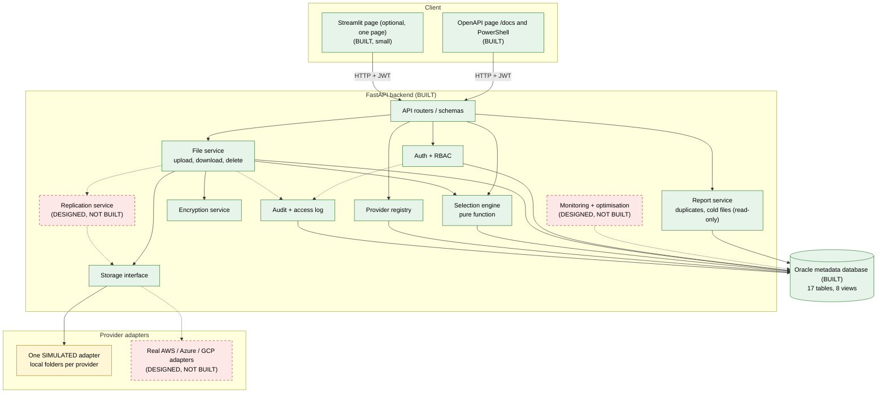
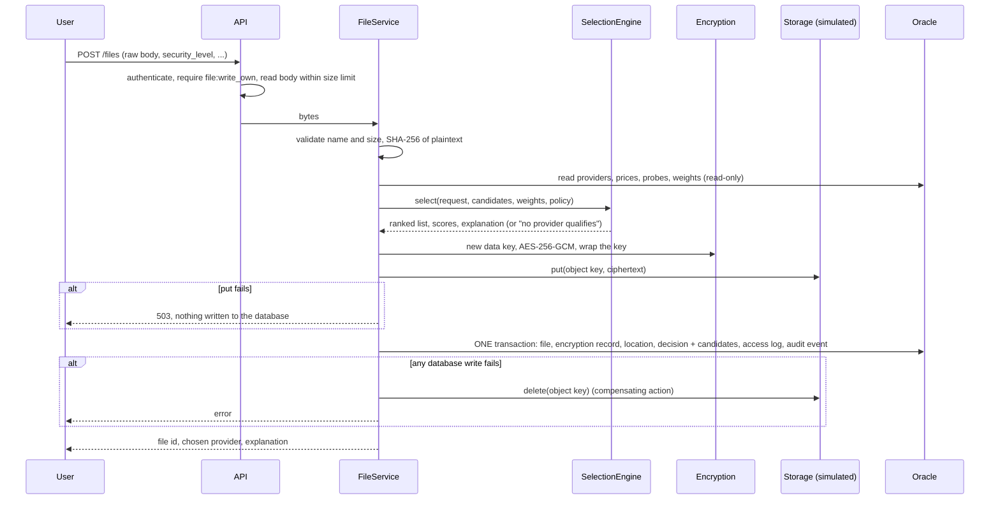

# System design (refreshed after Chunk 7)

This document was first written in Chunk 0 (before any code) and has been **refreshed to say what
actually exists**. Every part of the design carries one of these labels:

| Label | Meaning |
|---|---|
| **BUILT** | implemented and tested; evidence is named |
| **PARTLY BUILT** | some of it exists; the missing part is stated |
| **DESIGNED, NOT BUILT** | a plan only. It is **not** a feature of the project |
| **SIMULATED** | implemented, but against a stand-in (local folders, made-up prices), not a real cloud |

Companion documents: `01-schema-audit.md` and `01-data-dictionary.md` (database), `03-selection-engine.md`,
`04-storage-encryption.md`, `05-test-report.md` (results tables), `06-limitations-and-objectives.md`,
`07-report-outline-and-demo.md`, `08-demo-runbook.md` (manual demo commands), `09-reports.md` (duplicate and cold-file reports).

## Status at a glance

| # | Module | Status |
|---|---|---|
| M1 | Database and schema | **BUILT** |
| M2 | Authentication and RBAC | **BUILT** (no lockout, no password reset, no token revocation) |
| M3 | Provider registry and pricing | **BUILT** (prices and scores are illustrative) |
| M4 | Selection engine | **BUILT** |
| M5 | Storage abstraction and adapters | **BUILT, SIMULATED** (one local-folder adapter; no real cloud adapter) |
| M6 | Encryption service | **BUILT** (AES-256-GCM is real; the master key is **SIMULATED** KMS) |
| M7 | File and metadata service (upload, download, delete) | **BUILT** |
| M8 | Replication and recovery | **DESIGNED, NOT BUILT** (schema columns and a view exist; no code) |
| M9 | Audit and access logging | **BUILT** |
| M10 | Monitoring and analytics | **DESIGNED, NOT BUILT** (SQL views exist; no monitoring module, no usage, cost or performance reports, no charts) |
| M11 | Duplicate detection and optimisation | **PARTLY BUILT** (chunk 6: read-only duplicate-file and cold-file reports; **not built:** recommendations, savings, payback, migration) |
| M12 | API and dashboard | **BUILT** (small): the API and its OpenAPI page, the scripted demo `scripts/demo.py`, and one optional Streamlit page `dashboard.py`; **monitoring pages and charts are DESIGNED, NOT BUILT** |

---

## A. Problem statement

Organisations that store files across several cloud providers (AWS S3, Azure Blob, Google Cloud Storage) face:

1. **Fragmented metadata.** Each provider keeps its own listing. Nothing answers "where is this file, who owns
   it, how sensitive is it, and who touched it?" across providers.
2. **Hard-to-compare providers.** Prices, latency, reliability and security come in different units and tiers.
3. **Opaque selection.** Placement follows habit or the lowest per-GB price, and nobody can say why a file went where it did.
4. **Poor visibility into usage and access.** Hot, cold and duplicated files are not identified.
5. **Access-control weaknesses.** Provider IAM is per account; there is no single role model or read-only auditor.
6. **Provider outages.** A single copy is unavailable when its provider is down.
7. **Wasted spend.** Duplicates and cold data on expensive tiers cost money unnoticed.

**Goal.** A centralised, normalised (3NF) Oracle metadata system with an explainable, configurable
weighted-selection engine, role-based secure storage, and (planned) replication and monitoring.

**Scope actually delivered:** problems 1, 2, 3 and 5 are addressed, and data exposure is addressed by encryption.
**Problems 4 and 7 are partly addressed:** duplicate and cold files are now *identified* by read-only reports (exact
duplicates within one owner; cold files as candidates for review), but nothing recommends, prices or performs a move, and
there are no usage, cost or performance reports or charts. **Problem 6 (outages) is only designed:** no replication or failover.

## B. Gap table

| Gap | Conventional approach | This project's solution | Module | Metric | Status |
|---|---|---|---|---|---|
| G1 fragmented metadata | per-provider listings | one relational schema: 17 tables in 3NF, 27 foreign keys, 60 CHECK constraints | M1 | 3NF analysis, every FK enforced | **BUILT** (`01-schema-audit.md`) |
| G2 slow metadata queries | full scans on growing logs | indexes tied to named queries, EXPLAIN before/after | M1 | plan and buffer reads | **BUILT** (100,000-row run recorded; the 10,000-row run is yours to do) |
| G3 cheapest-only or random placement | single criterion | hard filters then a weighted five-metric score | M4 | different profiles give different winners | **BUILT** (`03-selection-engine.md`) |
| G4 opaque selection | no explanation stored | per-metric scores and an explanation stored for every upload | M4, M7 | decision and candidate rows exist | **BUILT** |
| G5 weak access control | shared credentials, no auditor role | JWT, USER / ADMIN / AUDITOR permission table, ownership checks | M2 | authorisation matrix tests | **BUILT** |
| G6 unclear audit trail | scattered, mutable logs | append-only `audit_events` (trigger-enforced) plus `access_logs` | M9 | one audit row per covered action | **BUILT** (requests with an invalid token are not audited) |
| G7 data exposure | plaintext at rest | AES-256-GCM envelope encryption before storage | M6 | stored bytes never equal plaintext; tamper fails | **BUILT** (key management SIMULATED) |
| G8 outage impact | single copy, manual failover | replica placement and failover read | M8 | download succeeds with primary down | **DESIGNED, NOT BUILT** |
| G9 duplicate waste | not detected | SHA-256 grouping, wasted-bytes estimate | M11 | seeded duplicates found | **BUILT** (chunk 6: read-only report, exact duplicates within one owner; see `09-reports.md`) |
| G10 cold data on dear storage | no visibility | idle-time rules and archive recommendations | M10, M11 | each recommendation cites evidence | **PARTLY BUILT** (cold files are listed with evidence as "candidate for archival review"; no recommendation, saving or payback) |
| G11 silent replication drift | unknown copy state | per-replica status and job history | M8 | status counts match the database | **DESIGNED, NOT BUILT** (columns exist, nothing writes them except `OK`/`PENDING_DELETE` on upload/delete) |
| G12 unverifiable claims | "looks cheaper" | simulated figures flagged `is_illustrative` and warned in every selection response | M3, M4 | flag present, warning shown | **PARTLY BUILT** (the planned `assumptions.md` was not written; see `06-limitations-and-objectives.md`) |

## C. Architecture (built, simulated and not built)


Dashed red boxes and dashed arrows are plans only. The Streamlit page is optional and tested headlessly. The yellow box is a stand-in for a cloud.

Rules the design enforces (all BUILT): clients never touch the database or providers; only the file service
orchestrates; only adapters touch stored bytes; only the repository layer runs SQL; encryption happens before
bytes reach an adapter, so a provider only ever receives ciphertext.

## D. Workflows

### D1. Register and login: **BUILT**
Register creates a USER only (roles are never self-assigned); passwords are Argon2id hashed. Login returns a JWT
(30 minutes). Every request re-reads the user's role and status from the database. Events `USER_REGISTERED`,
`LOGIN_OK`, `LOGIN_FAILED`, `ACCESS_DENIED` are audited. Not built: lockout after repeated failures.

### D2. Upload: **BUILT** (storage SIMULATED)

Not built: a sweep for objects orphaned by a crash between `put` and `commit`.

### D3. Provider selection: **BUILT** (see `03-selection-engine.md`)
Hard filters (enabled, not DOWN, priced, latency measured, **size fits**, security and reliability minimums),
cost for this file, min-max normalisation over eligible providers only (all-equal gives 1.0), direction, weighted
sum with validated weights, deterministic tie-break (security, reliability, cost, provider id, region id).

### D4. Download: **BUILT**
Authorise and check ownership; fetch; verify the SHA-256 of the stored bytes; decrypt (GCM authenticates);
verify the SHA-256 of the plaintext; write an access-log row with measured latency and outcome. Failure over to a
second copy is **not built** (there is only one copy).

### D5. Delete: **BUILT**
Needs `confirm=true`. One transaction: status DELETED, the encryption record removed (crypto-erase), location
marked `PENDING_DELETE`, access log and audit event. Then the object is removed. If removal fails the key is
still gone and the location stays `PENDING_DELETE` (no retry job).

### D6. Replication: **DESIGNED, NOT BUILT**
Plan: for each target, copy ciphertext from a healthy replica, write the replica row `OK`, or record the job
`FAILED` and retry; the file's replication state is `FULL`, `PARTIAL` or `NONE`. Built so far: the tables
(`replication_jobs`, `storage_locations.replica_status`, `files.desired_replicas`) and the view
`v_file_replication_status`. Nothing creates replicas.

### D7. Provider failure: **PARTLY BUILT**
Built: a region marked `DOWN` is excluded from new selections, and the status change is audited. Not built:
failover reads, degraded-file flags, or repair after recovery.

### D8. Duplicate detection: **BUILT (chunk 6)**
`GET /reports/duplicates` groups a user's live files by plaintext SHA-256 and reports copies, wasted bytes and an
estimated monthly waste from the (illustrative) price table. Exact duplicates only, within one owner; near-duplicates
are not detected. Read-only. See `09-reports.md`.

### D9. Cold files and migration recommendation: **PARTLY BUILT**
Built (chunk 6): `GET /reports/cold-files` lists files idle for more than a threshold with few recent downloads, with
evidence and the label "candidate for archival review". **Not built:** pricing a cheaper tier, recommendations, saving,
payback, approval, and any migration. The `recommendations` table is unused.

## E. Module output matrix

| # | Module | Inputs | Processing | Independent output | DB tables | Status and evidence |
|---|---|---|---|---|---|---|
| M1 | Database and schema | DDL, seed data | 3NF design, constraints, indexes, views, migration | created schema, row counts, constraint errors, EXPLAIN plans | all 17 | **BUILT**; `install_fresh.log`, `demo_*.log`, `explain_100k.log` |
| M2 | Auth and RBAC | credentials, JWT | Argon2, token issue and check, permission table | tokens, 401/403 responses | `users` | **BUILT**; `test_api_auth`, `test_api_rbac`, `test_rbac_table` |
| M3 | Provider registry | provider, region, tier prices | admin CRUD, audit | provider catalogue | `cloud_providers`, `provider_regions`, `provider_pricing`, `performance_measurements` | **BUILT**; `test_api_providers`, `test_oracle_providers` |
| M4 | Selection engine | file profile, candidates, weights | filters, cost, normalise, score, rank, explain | ranked list, scores, explanation | `weight_profiles`, `system_config` (read); decisions are written by M7 | **BUILT**; `test_selection_*`, worked example |
| M5 | Storage and adapters | object key, bytes | local-folder put/get/delete/exists | stored objects | none | **BUILT, SIMULATED**; `test_crypto.py` (adapter tests) |
| M6 | Encryption | plaintext, master key | AES-256-GCM, key wrap | ciphertext, wrapped key, nonce | `file_encryption` | **BUILT**; `test_crypto.py` |
| M7 | File service | upload/download/delete requests; list and placement reads | orchestration, compensating delete | file records, locations, decisions; the owner's file list and saved placement explanation | `files`, `file_encryption`, `storage_locations`, `selection_decisions`, `selection_candidates` | **BUILT**; `test_files_api`, `test_api_file_views`, `test_oracle_files`, `test_oracle_file_views` |
| M8 | Replication and recovery | file id, targets | copy, retry, repair | replica status, job history | `replication_jobs`, `storage_locations` | **DESIGNED, NOT BUILT** |
| M9 | Audit and access log | events from all services | append-only inserts | audit and access history | `audit_events`, `access_logs` | **BUILT** |
| M10 | Monitoring | logs, files, prices | aggregations | KPI tables, dashboard data | views only | **DESIGNED, NOT BUILT** |
| M11 | Duplicates and optimisation | hashes, access logs, prices | grouping by owner and hash; idle and download-count rules | duplicate groups with wasted bytes and estimated waste; cold-file candidates with evidence (read-only) | `files`, `access_logs`, `storage_locations`, `provider_pricing`, `system_config` (read) | **PARTLY BUILT**; `test_reports_logic`, `test_api_reports`, `test_oracle_reports`; savings, recommendations and the `recommendations` table are not built or used |
| M12 | API and dashboard | HTTP requests | FastAPI routes; one optional Streamlit page | OpenAPI page, `scripts/demo.py` and `dashboard.py` work; no monitoring pages or charts | none | **BUILT** (small) |

## F. Technology stack

| Choice | Used? | Trade-off and note |
|---|---|---|
| FastAPI (with Pydantic) | **yes** | typed request models and an automatic OpenAPI page; the Oracle driver blocks, so routes run in a thread pool |
| `oracledb`, thin mode | **yes** | no Oracle client install; Oracle only |
| Hand-written parameterised SQL (not SQLAlchemy) | **yes** | the database work stays visible and exact; more boilerplate; an automated scan checks that every `execute` receives a constant SQL string |
| `argon2-cffi` (Argon2id) | **yes** | memory-hard hashing |
| `PyJWT` (HS256, 30 minutes) | **yes** | stateless; no server-side revocation |
| `cryptography` | **yes** | AES-256-GCM; key management is simulated |
| `python-dotenv`, `uvicorn` | **yes** | `.env` loading; the server |
| `pytest`, `pytest-cov`, `httpx`, `ruff` | **yes** | tests, coverage, lint and format |
| Streamlit (with pandas, requests) | **optional** | used only by `dashboard.py`; pinned in `requirements-optional.txt`, installed in a separate virtual environment, not needed by the API, tests or demo. Plotly is not used |
| Docker, CI pipeline, mypy | **no** | not part of the project |

Simulated versus real: the metadata, auth, RBAC, audit, selection logic, encryption algorithm and replication
*schema* are real. Providers, prices, latency probes, the size caps, the master key (stands in for a KMS) and
storage itself are simulated. See `06-limitations-and-objectives.md`.

## G. Requirements and their status

| Req | Statement | Status |
|---|---|---|
| FR-1 | register and log in; hashed passwords; JWT with expiry | **Met** |
| FR-2 | roles USER, ADMIN, AUDITOR; AUDITOR read-only | **Met** (ADMIN has no own-file permissions; documented) |
| FR-3 | maintain providers, tiers, prices, metrics | **Partly met**: providers, regions, scores, health and prices via the API; latency probes only by SQL or seed |
| FR-4 | upload returns the chosen provider and explanation | **Met** |
| FR-5 | weighted, configurable, deterministic selection with hard constraints and stored scores | **Met** |
| FR-6 | download with decryption, integrity check and failover | **Partly met**: decryption and integrity yes, failover no |
| FR-7 | soft delete with key destruction | **Met** (file versions dropped from scope) |
| FR-8 | optional replication and per-replica status | **Not built** |
| FR-9 | encrypt before data leaves the service | **Met** |
| FR-10 | log authentication events, state changes and file access | **Met**, except requests with an invalid token are not audited |
| FR-11 | duplicate detection | **Met** (chunk 6, read-only report) |
| FR-12 | cold-file detection and recommendations | **Partly met**: detection yes (chunk 6), recommendations no |
| FR-13 | dashboard | **Partly met**: one optional Streamlit page (`dashboard.py`: files, placement, duplicate and cold tables); no charts or monitoring pages |
| FR-14 | documented API and a scripted demo | **Met**: OpenAPI page and `scripts/demo.py` |
| FR-15 | transactions, savepoints, no orphan metadata | **Met** |
| NFR-1 | integrity: 3NF, PK/FK/UNIQUE/NOT NULL/CHECK | **Met** |
| NFR-2 | security: bound SQL, no secrets in the repository, least privilege | **Met**; not built: lockout, rate limiting, TLS |
| NFR-3 | performance: indexes, improved plans | **Met** (100,000-row run recorded; 10,000-row run pending) |
| NFR-4 | reliability: atomic upload, recoverable after partial failure | **Partly met**: atomic with compensation; no orphan sweep |
| NFR-5 | explainability: every placement reproducible from stored inputs | **Met** |
| NFR-6 | testability without the other modules | **Met** |
| NFR-7 | maintainability: layered, lint-clean | **Met** |
| NFR-8 | portability: one `.env`, runs on Windows | **Met** |
| NFR-9 | honesty: simulated values labelled | **Met** (flag in the database, warnings in responses) |
| NFR-10 | demo scale only | **Met** (tested with 100,010 log rows) |

## H. Folder structure (as built)

```
app/
  main.py                      application factory and error handlers
  config.py                    settings from environment variables only
  db/                          base.py (interfaces), pool.py (pool and transaction helper), errors.py,
                               repositories/ (users, audit, providers, files, reports: all SQL, bind variables only)
  auth/                        passwords.py, tokens.py, rbac.py (permission table), service.py, deps.py
  audit/service.py             audit events
  providers/                   module 3: registry service and row types
  selection/                   module 4: engine.py (pure), models, presets, explain, baselines, example, serialize, service
  crypto/service.py            AES-256-GCM envelope encryption
  storage/                     base.py (interface), simulated.py (the one adapter)
  files/                       upload, download, delete, list and placement service; errors; row types
  reports/                     chunk 6: models.py, service.py (arithmetic, thresholds, labels), sample_data.py (synthetic sample)
  api/                         schemas*.py, routers/ (auth, health, protected, providers, selection, files, reports)
scripts/                       demo.py, set_password.py, worked_example.py, make_review_package.py
dashboard.py                   optional one-page Streamlit view (calls the API only)
sql/                           schema, indexes, views, seeds, migration, demos, synthetic data, cleanup,
                               reports.sql, seed_reports_config.sql, demo_queries.sql, explain_reports.sql
schema.sql (repository root)   the ORIGINAL five-table schema as first uploaded; the revised schema is sql/schema.sql
docs/                          design, audit, data dictionary, run guide, engine, storage, test report, limitations,
                               outline, demo runbook, reports
tests/unit/                    tests with an in-memory database and a real simulated adapter
tests/integration/             tests against Oracle (you run them)
requirements*.txt, pyproject.toml, .env.example, README.md
```

## I. Milestones and their status

| Chunk | Delivered | Status |
|---|---|---|
| 0 | this design | **Done** (refreshed here) |
| 1 | schema audit, revised schema, migration, demos, EXPLAIN | **Done**; optional runs not yet done: 10,000-row EXPLAIN, legacy migration |
| 2 | auth, RBAC, audit, health | **Done** |
| 3 | provider registry, selection engine | **Done** |
| 4 | simulated storage, encryption, upload, download, delete | **Done** |
| 5 | replication and failover | **Not built** |
| 6 | duplicate and cold-file reports | **Built** (`09-reports.md`) |
| 7 | demo script and dashboard | **Built** (command-line demo, live SQL, one optional Streamlit page; see README) |
| 8 | test report, limitations, objective map, outline | **This documentation set** (results tables left for you to fill) |

## J. Decisions that differ from the Chunk 0 design

* **File versions dropped**: a replacement is a new file. **`provider_events` dropped**: health lives on `provider_regions`, history in `audit_events`.
* **Selection results are stored** (`selection_decisions`, `selection_candidates`) and **weights live in `weight_profiles`** so the database enforces that they sum to 1.
* **One managed bucket per provider-region** (so "same file, same provider and region" is a plain UNIQUE constraint).
* **Size fit is a hard filter**, not a scored criterion. **All-equal metrics score 1.0** (no division by zero).
* **Upload uses a compensating delete**; the promised orphan sweep was not built.
* **Plaintext hashes reveal file existence** (limitation L-1): `content_sha256` is a hash of the plaintext.
* **Duplicates are reported within one owner** and a duplicate group's original is the oldest upload; copies of the same content owned by
  two users are not reported (each file has its own key and owner).
* **A cold file needs two things**: idle more than N days *and* fewer than M successful downloads in a longer window (default 90 days, 3, 365).
  A separate window is needed because a 30-day count is always zero for a file idle 90 days.
* **The reports have their own read-only SQL**; the chunk 1 views `v_duplicate_files`, `v_file_access_stats`, `v_region_usage` and others are not used by any code.
* **The scripted demo acts only through the API** and reads the database only with SELECT; its two labelled direct writes are the role of its own
  synthetic accounts and the synthetic report sample.
* **File upload takes the raw body** (no multipart library); the optional dashboard's dependencies are kept out of the main environment.
