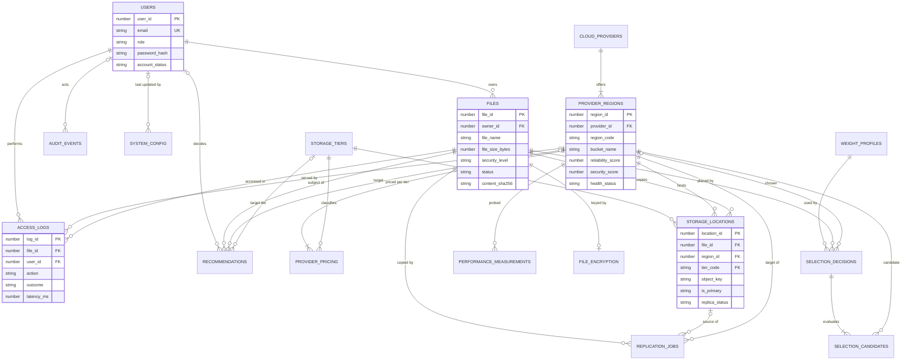

# Chunk 1: Schema audit, revised design, index strategy

Status: **NOT EXECUTED.** Nothing here has been run against Oracle. Statements about plans, counts and errors are expectations to be confirmed by your pasted output (see `01-run-guide.md`).

Files produced: `sql/` (scripts), `docs/01-data-dictionary.md`, `docs/01-run-guide.md`, `docs/01-explain-results.md` (blank, for your output).

---

## 1. Audit of the existing 5-table schema

A single-column surrogate primary key makes every table trivially satisfy "all attributes depend on the key". That proves nothing about the *real* dependencies in the data. So for each table I list the candidate keys the data really has, the functional dependencies (FDs) that hold in the domain whether or not the schema declares them, and what breaks.

Notation: `A -> B` means A determines B. "Declared" = enforced by a constraint.

### 1.1 Users

| Item | Finding |
|---|---|
| Candidate keys | `{UserID}` (declared), `{Email}` (declared UNIQUE, but case-sensitive: `Harini@x.com` and `harini@x.com` are both accepted, so it is **not** a true key) |
| FDs | `UserID -> Name, Email, Role, CreatedAt`; `Email -> UserID` (intended) |
| Partial dependencies | None (single-column key) |
| Transitive dependencies | None. `Role` is a 3-value domain, not an entity with attributes |
| Normal form | 3NF/BCNF on paper |
| Insertion anomaly | None structural. A user can be created with no credentials, so nothing can authenticate them |
| Update anomaly | Changing an email touches one row. Fine |
| Deletion anomaly | The FKs from Files and Access_Logs have no `ON DELETE` clause, which means Oracle refuses the delete (ORA-02292). Safe, but undocumented and there is no soft-delete status |
| Real defects | `Role` is nullable: `CHECK (Role IN (...))` is **satisfied by NULL**, so a NULL role slips through. No password hash, status, lockout or last-login columns |

### 1.2 Cloud_Providers

| Item | Finding |
|---|---|
| Candidate keys | `{ProviderID}` declared. The intended natural key `{ProviderName, Region}` is **not declared**: two identical rows are allowed |
| FDs | `ProviderID -> ProviderName, Region, ReliabilityScore, SecurityScore`. The scores depend on `(ProviderName, Region)` if they are per provider-region, or on `ProviderName` alone if per provider (see 2.1) |
| Partial / transitive | If scores are per provider: `ProviderID -> ProviderName -> scores` is a **transitive dependency**. If per provider-region: the table mixes two entities (provider identity and a provider-region) in one row |
| Normal form | Violates 3NF (case A) or conflates two entities (case B). Either way it needs a split |
| Insertion anomaly | A provider cannot be registered without picking a region (Region nullable, so technically yes, but then it is a provider with an unknown location). Adding a second region repeats `ProviderName` |
| Update anomaly | Renaming "Google Cloud" means updating every region row. Miss one and the data disagrees |
| Deletion anomaly | Deleting the only row of a provider-region deletes the provider's existence |
| Real defects | `ReliabilityScore` and `SecurityScore` are nullable. `CHECK ... BETWEEN 0 AND 10` passes NULL. A NULL score would silently break weighted scoring |

### 1.3 Files

| Item | Finding |
|---|---|
| Candidate keys | `{FileID}` only. There is no natural key: `(UserID, FileName)` is plausible but undeclared, and duplicates are legitimate (the same name uploaded twice). I keep it that way on purpose and rely on `file_id` in object keys to avoid storage collisions |
| FDs | `FileID -> UserID, FileName, FileSize, FileType, UploadTime, AccessFrequency, SecurityLevel` |
| Partial dependencies | None |
| Transitive dependencies | `FileName -> FileType` would hold if the type were just the extension. I **reject** treating it as an FD: the type is user-supplied metadata and extensions are unreliable (`.dat`, no extension). It stays an attribute but is constrained to a list |
| Cross-table redundancy | `AccessFrequency` is **derivable from Access_Logs**. Not an FD inside Files, but a redundancy: two sources of truth |
| Insertion anomaly | A file can exist with no storage location and no hash, so "where is it and what is it" has no answer |
| Update anomaly | Every log insert requires `UPDATE Files SET AccessFrequency = AccessFrequency + 1`. If the application forgets, or the update fails after the log insert, the counter lies. **This already happened in the supplied data**: see 2.2 |
| Deletion anomaly | Deleting a file with logs is refused (FK). Without a status column there is no soft delete |
| Real defects | `SecurityLevel` nullable (CHECK passes NULL); `FileType` free text; `AccessFrequency` nullable; no hash, status, encryption info, desired copies |

### 1.4 Storage_Locations

| Item | Finding |
|---|---|
| Candidate keys | `{LocationID}` declared. Intended but **undeclared**: `{FileID, ProviderID, Region}` (one copy per file per provider-region) and `{ProviderID, BucketName, ObjectKey}` (one object, one place) |
| FDs | `LocationID -> all`. Domain FDs that hold but are not declared: `(ProviderID, BucketName) -> Region` (a bucket lives in exactly one region), and `StorageClass` only makes sense for its provider (`HOT` is an Azure term, `STANDARD` is AWS/GCS) |
| Partial dependencies | None (single-column key) |
| Transitive dependencies | **Yes.** `LocationID -> BucketName -> (ProviderID, Region)`. Provider and region are determined by the bucket, not by the location |
| Normal form | Violates 3NF through the bucket dependency |
| Inclusion dependency broken | `(ProviderID, Region)` here must exist in Cloud_Providers. Nothing enforces it. `INSERT ... ProviderID=1 (AWS), Region='Central India'` is accepted although AWS has no such row |
| Insertion anomaly | Can record a file in a provider-region that does not exist; can record the same file twice at the same place |
| Update anomaly | If a bucket's region is wrong, every row for that bucket needs fixing |
| Deletion anomaly | When the last file in a bucket is removed, the fact that the bucket exists in that region is lost |
| Real defects | `Region`, `BucketName`, `ObjectKey`, `StorageClass` all nullable; no replica status; no primary flag; `StorageClass` free text |

### 1.5 Access_Logs

| Item | Finding |
|---|---|
| Candidate keys | `{LogID}`. `(FileID, UserID, Action, AccessTime)` is a *plausible* natural key but two events can share a timestamp, so I do not declare it |
| FDs | `LogID -> FileID, UserID, Action, AccessTime, Latency` |
| Partial / transitive | None |
| Normal form | 3NF |
| Insertion anomaly | None structural |
| Update anomaly | None (logs should never be updated; there is no immutability rule) |
| Deletion anomaly | Deleting a user or file is blocked by FKs: good, because logs are evidence |
| Real defects | `Action` unconstrained (typos like `Download` vs `DOWNLOAD`); no outcome, so a failed download and a successful one are indistinguishable and a failure with `Latency = NULL` looks like missing data; `Latency` has no unit; no record of which provider served the request, so per-provider latency cannot be computed; `AccessTime` nullable |

### 1.6 Other defects found in the supplied script

| # | Finding | Consequence |
|---|---|---|
| X1 | `File_Metadata_View` uses INNER JOINs to Storage_Locations | A file with no location disappears from the view, which hides exactly the files that need attention |
| X2 | `EXPLAIN PLAN` was run on 3 rows | The optimizer correctly picks a full scan on tiny tables, so the "before/after" showed nothing. Needs synthetic volume |
| X3 | `idx_files_security` on a 3-value column | Low selectivity; the optimizer will not use it for a typical query. Not recreated |
| X4 | Foreign keys without supporting indexes | Oracle does not index FKs automatically. Parent deletes and joins on the child side scan the child table |
| X5 | The transaction demo ends with `ROLLBACK TO` then `COMMIT` and the sample data keeps `admin_draft.docx` | Fine as a demo, but the demo never shows a *failed* statement, only a manual rollback |
| X6 | Seeded `AccessFrequency` (12, 7, 2) disagrees with the three seeded log rows (1, 1, 0 downloads) | Concrete proof of the update anomaly in 1.3 |

---

## 2. The suspected problems: confirmed or rejected

| # | Suspicion | Verdict | Evidence | Resolution |
|---|---|---|---|---|
| 2.1 | Region is in both Cloud_Providers and Storage_Locations. Are scores per provider or per provider-region? | **Confirmed**, and scores are decided **per provider-region** | Region duplicated in two tables with no link; inclusion dependency unenforced (1.4); a provider with 2 regions needs 2 rows repeating the name (1.2) | New `cloud_providers` (identity, size cap) and `provider_regions` (scores, bucket, egress, health). `storage_locations` stores only `region_id`, so provider and region cannot disagree. **Decision D-1 below** |
| 2.2 | `AccessFrequency` is derivable: keep as documented denormalization, or replace with a view? | **Confirmed redundancy. Replace with a view** | Seed data already inconsistent (X6). Each log insert needs a second write that can fail independently | Column dropped. `v_file_access_stats` computes total, 30-day and last download from `access_logs`. Cost: an aggregate per file listing, covered by `ix_logs_file_time`. If chunk 6 profiling shows it is too slow, the fix is a refreshed materialized view, never a hand-maintained counter. "Access" is defined as a successful DOWNLOAD |
| 2.3 | No content hash, file status, encryption metadata on Files | **Confirmed** | Chunk 4 needs them for duplicate detection, soft delete and decrypt | `files.content_sha256`, `status`, `desired_replicas`, `deleted_at`; new 1:1 table `file_encryption` |
| 2.4 | No password hash, account status, last-login on Users | **Confirmed** | Chunk 2 cannot authenticate otherwise | Added `password_hash`, `account_status`, `failed_login_count`, `locked_until`, `last_login_at`. `ck_users_pwd` forbids an ACTIVE account without a hash |
| 2.5 | No ON DELETE behaviour | **Confirmed** (default is implicit RESTRICT) | See section 7 | Explicit policy per FK, section 7 |
| 2.6 | Storage_Locations lacks uniqueness for same file at same provider and region | **Confirmed** | 1.4 | `uq_locations_file_region (file_id, region_id)` (region implies provider), `uq_locations_region_key (region_id, object_key)`, and a unique function-based index allowing at most one primary per file |
| 2.7 | Action, FileType, StorageClass unconstrained; latency has no outcome | **Confirmed** | 1.3, 1.4, 1.5 | `ck_logs_action`, `ck_files_type`; StorageClass replaced by FK to `storage_tiers` (provider-neutral); `outcome` column; latency renamed `latency_ms` |
| 2.8 | SecurityLevel nullable: should it be NOT NULL? | **Confirmed. NOT NULL, no default** | A NULL passes the CHECK and would bypass the HIGH-security hard filter | `files.security_level NOT NULL`. No DB default: the caller must choose, because a silent default of LOW would be unsafe and MEDIUM would hide omissions |

**Decision D-1 (needs your confirmation).** Security certifications are largely provider-wide, so a purist could place `security_score` on `cloud_providers`. I put both scores on `provider_regions` because the engine selects a *region*, data-residency posture does differ by region, and the simulated data wants to vary them. Cost: changing a provider-wide score means updating each of its regions. If you prefer provider-level security, it is a one-column move before chunk 3.

**Design rule R-1.** One managed bucket per provider-region (`uq_regions_provider_code`, `bucket_name` on `provider_regions`). Real accounts can have many buckets; this project uses one per region and namespaces files by `object_key`. This is what lets "same file, same provider and region" be a plain UNIQUE constraint and keeps the bucket-to-region dependency out of `storage_locations`. The legacy sample data already satisfies it (three buckets, three regions).

---

## 3. Added tables, with FDs and 3NF justification

Only structures that a later chunk needs are included. "Chunk" says who needs it.

### 3.1 Tables added

| Table | Chunk | Why it exists | Key | FDs (all non-key attributes) | 3NF argument |
|---|---|---|---|---|---|
| `storage_tiers` | 3,6 | Provider class names (`STANDARD`, `HOT`, `NEARLINE`) are not comparable; a neutral tier makes cross-provider cost comparison and archive recommendations possible | `tier_code` | `tier_code -> tier_rank, description`; `tier_rank` also unique | Single determinant |
| `provider_regions` | 1,3 | Splits provider identity from the thing that is actually chosen (2.1) | `region_id`; candidate keys `(provider_id, region_code)`, `(provider_id, bucket_name)` | `region_id -> provider_id, region_code, bucket_name, scores, egress, health, flags`. `egress` is per region and independent of tier, so it lives here, **not** in pricing | Every FD's left side is a candidate key, so it is BCNF |
| `provider_pricing` | 3,6 | Storage, retrieval and request prices, **illustrative**, per region and tier | `(region_id, tier_code)` | `(region_id, tier_code) -> native_class_name, storage, retrieval, put, get, min_days, flag` | Egress is *deliberately absent*: it depends on `region_id` alone, which would be a partial dependency (violates 2NF) |
| `weight_profiles` | 3 | Named, switchable weights; the database enforces that they sum to 1 | `profile_name` | `profile_name -> description, 5 weights, is_default` | Fixed set of five criteria makes a wide row correct and lets `ck_weights_sum` work. A row-per-criterion design could not express "sum = 1" as a CHECK |
| `system_config` | 2,3,5,6 | Thresholds (security minimums, cold-file days, lockout) | `config_key` | `config_key -> value, description, updated_*` | Key-value store for scalar settings is normal for configuration; weights were split out precisely because they have a cross-column rule |
| `file_encryption` | 4 | Envelope-encryption metadata: wrapped DEK, nonce, algorithm, master key version, ciphertext hash | `file_id` (also FK) | `file_id -> all` | 1:1 with files. Separate so crypto-erase is "delete one row" and so DB-level grants can hide key material from reporting roles. The master key is **not** stored in the database |
| `replication_jobs` | 5 | Queue and history of replicate / repair / migrate / delete work | `job_id` | `job_id -> file_id, source_location_id, target_region_id, type, status, attempts, errors, timestamps` | Single-key table, no non-key chains. The target *location* is not stored because `(file_id, target_region_id)` already identifies it via the unique constraint |
| `performance_measurements` | 3,6 | Provider probes independent of user traffic, so regions with no traffic still have latency data; marks `SIMULATED` vs `MEASURED` | `measurement_id` | `measurement_id -> region, time, operation, latency, success, payload, source` | Single key |
| `selection_decisions` | 3 | The persisted explanation (objective 2: "must explain its choice") | `decision_id` | `decision_id -> file, profile, weights snapshot, chosen region, explanation, time` | `weights_json` is a deliberate **snapshot**: profile rows can change later and history must not. Documented exception to "no derived data" |
| `selection_candidates` | 3 | Per-region scores and exclusion reasons for each decision | `(decision_id, region_id)` | `... -> excluded_reason, raw_json, 5 normalised scores, total_score` | `total_score` is derivable from the scores and the weights but stored as the engine's recorded output, so a test can detect disagreement. Excluded rows carry a reason and no scores (`ck_candidates_shape`) |
| `recommendations` | 6 | Archive / migrate / deduplicate suggestions with their evidence and money | `recommendation_id` | `... -> type, file, related file, target region/tier, saving, migration cost, evidence, status, decision` | Saving and evidence are snapshots at creation time. `evidence_json` is an opaque document that is never queried by field, so it does not break 1NF in practice |
| `audit_events` | 2+ | Append-only security and state-change trail | `event_id` | `event_id -> time, actor, type, target, outcome, ip, details` | `target_type/target_id` is a polymorphic reference with **no FK on purpose**, so history survives purges. A trigger blocks UPDATE and DELETE |

### 3.2 Tables considered and rejected

| Candidate | Decision | Reason |
|---|---|---|
| `file_versions` (in the chunk 0 design) | **Removed from scope** | No chunk needs it; replacing a file creates a new file. Saves a table and joins. Chunk 0 text is amended |
| `provider_events` (outages) | Rejected | `provider_regions.health_status` holds current state; transitions go to `audit_events` (`PROVIDER_STATUS_CHANGED`) and probes to `performance_measurements` |
| `encryption_keys` table with the master key | Rejected | The master key must not live next to the data it protects; it comes from the environment (simulated KMS) |
| `roles` lookup | Rejected | Three fixed values with no attributes; a CHECK is simpler and cannot be forgotten in a join |
| `file_types` lookup | Rejected | A one-column table; CHECK list with an `OTHER` fallback is enough. Trade-off: adding a type needs one DDL change |
| `buckets` table | Rejected | Collapsed into `provider_regions` by rule R-1 |
| `duplicate_scan_runs` | Rejected | `v_duplicate_files` answers it from current data; no history requirement |
| `weight` rows per criterion | Rejected | Cannot enforce sum = 1 declaratively |

### 3.3 Re-derivation after the redesign (normal form check)

All tables now have every non-key attribute determined by a key, the whole key, and nothing but the key, except the two documented snapshot exceptions (`selection_*`, `recommendations`), the JSON snapshot columns, and the polymorphic `audit_events` reference. None of these affect integrity of live data.

---

## 4. ER diagram

---

## 5. Migration mapping

| Legacy | New | Rule |
|---|---|---|
| `Users` | `users` | ids kept; `Name -> full_name`; email lower-cased and trimmed (a collision after lower-casing aborts the migration, which is correct); no password, status `PENDING_RESET`; NULL role -> `USER` |
| `Cloud_Providers` | `cloud_providers` + `provider_regions` | one provider per distinct name (matched case-insensitively to the seed); one region per (name, region); scores copied if the region is not already seeded (MIN used if duplicated); NULL scores -> 5 |
| `Storage_Locations.Region` not declared by any provider | new `provider_regions` row | shows up in migration check 14 with scores 5/5 for you to review |
| `Files` | `files` | ids kept; `AccessFrequency` **not** copied (stays in `LEGACY_FILES`); NULL security -> `HIGH` (most restrictive; owner may lower it); unknown type -> `OTHER`; `content_sha256` NULL (unknown) |
| `Storage_Locations` | `storage_locations` | ids kept; first location of a file is primary; duplicates of (file, region) dropped; `StorageClass STANDARD/HOT -> tier HOT`; unknown class -> HOT; NULL object key -> `legacy/file-<id>`; status `OK` |
| `Access_Logs` | `access_logs` | ids kept; outcome assumed `SUCCESS` (legacy had none); `Latency` assumed milliseconds |
| `Files.AccessFrequency` | removed | check 11 prints counter vs real downloads |
| legacy indexes and view | not recreated | indexes replaced by section 6; view replaced by `v_file_metadata` |

Legacy tables are kept as `LEGACY_*`. `rollback_migration.sql` restores the original five tables.

---

## 6. Index strategy tied to real queries

Oracle auto-indexes primary keys and UNIQUE constraints, not foreign keys. A "free" index here means a constraint already provides it.

| Query | SQL shape | Used by | Index | Why |
|---|---|---|---|---|
| Q1 | `files WHERE owner_id=:u [AND status<>'DELETED'] ORDER BY upload_time DESC` | file list page, chunk 4 | `ix_files_owner_time (owner_id, upload_time)` | Equality then sort: no sort step. Also the FK index for `fk_files_owner` |
| Q1b | `files WHERE owner_id=:u AND file_name=:n` | find by name | `ix_files_owner_name (owner_id, file_name)` | Lookup and uniqueness checks in the app |
| Q2 | `access_logs WHERE file_id=:f ORDER BY access_time DESC` | access history, `v_file_access_stats`, cold-file detection | `ix_logs_file_time (file_id, access_time)` | Equality plus range order; also FK index for `fk_logs_file`. Read backwards (`INDEX RANGE SCAN DESCENDING`), so no `SORT ORDER BY` |
| Q3 | `access_logs WHERE user_id=:u ORDER BY access_time DESC FETCH FIRST 50` | user activity, AUDITOR view | `ix_logs_user_time (user_id, access_time)` | Top-N stops after 50 index entries. FK index for `fk_logs_user` |
| Q4 | `files GROUP BY content_sha256 HAVING COUNT(*)>1` and `WHERE content_sha256=:h` | duplicate detection at upload and scan | `ix_files_sha256` | Upload-time equality probe is the hot path |
| Q5 | `replication_jobs WHERE status IN ('QUEUED','FAILED') AND next_retry_at<=SYSTIMESTAMP` | job worker | `ix_jobs_status_retry (status, next_retry_at)` | Worker polls this repeatedly |
| Q5b | `replication_jobs WHERE file_id=:f` | file detail | `ix_jobs_file` | FK index with `ON DELETE CASCADE` (without it each file delete scans the jobs table) |
| Q6 | `access_logs WHERE served_by_region_id=:r AND access_time>:t` | latency by provider | `ix_logs_region_time` | Dashboard per-region latency |
| Q7 | `performance_measurements WHERE region_id=:r ORDER BY measured_at DESC` | selection baseline | `ix_perf_region_time` | Latest probe per region |
| Q8 | `audit_events` by time, by actor, by type | AUDITOR browsing | `ix_audit_time`, `ix_audit_actor_time`, `ix_audit_type_time` | Three browse filters. `ix_audit_actor_time` is also the FK index |
| Q9 | `recommendations WHERE status='OPEN' [AND rec_type=:t]`; by file | dashboard | `ix_rec_status`, `ix_rec_file` | Open list; FK index with CASCADE |
| Q10 | `selection_decisions WHERE file_id=:f` | explain a placement | `ix_selection_file` | FK index with CASCADE |

**Free via constraints:** `storage_locations(file_id)` leads `uq_locations_file_region`; `storage_locations(region_id)` leads `uq_locations_region_key`; `provider_regions(provider_id)` leads `uq_regions_provider_code`; `provider_pricing(region_id)` leads the primary key.

**Deliberately not indexed:** `storage_locations(tier_code)`, `provider_pricing(tier_code)`, `recommendations(target_region_id, target_tier_code, decided_by)`, `selection_decisions(profile_name, chosen_region_id)`, `replication_jobs(target_region_id, source_location_id)`, `file_encryption`, `system_config(updated_by)`. The parents (`storage_tiers`, `provider_regions`, `weight_profiles`) are never deleted, so the unindexed-FK lock risk does not arise, and no listed query filters on these columns. Revisit if chunk 5 or 6 queries say otherwise. `files.status`, `security_level` are low-cardinality and rarely the leading filter; not indexed (the legacy `idx_files_security` is dropped for this reason).

**Honest expectation about the EXPLAIN PLAN demo:** Q2 should switch from `TABLE ACCESS FULL` plus `SORT ORDER BY` to an index range scan (descending); Q3 should use the user index with a `COUNT STOPKEY`; Q4 is a **control** and should look the same before and after, because it reads most of the table and the index does not contain `action` / `outcome`. If the optimizer picks a full scan for Q3 at 10,000 rows, that is a legitimate result (a user has about 1% of rows), and the 100,000-row run is where it should flip. Record whatever happens.

---

## 7. ON DELETE policy per relationship

Oracle offers NO ACTION (the default, behaves as RESTRICT: ORA-02292), CASCADE, and SET NULL. I use CASCADE only where the child is a pure dependent with no evidential value on its own.

| FK | Rule | Justification |
|---|---|---|
| `files.owner_id -> users` | RESTRICT | Users are disabled, never deleted; deleting must not erase files |
| `access_logs.file_id`, `.user_id`, `.served_by_region_id` | RESTRICT | Logs are evidence; a delete that would orphan or erase them must fail |
| `audit_events.actor_user_id` | RESTRICT | Same; also the table is append-only |
| `system_config.updated_by`, `recommendations.decided_by` | RESTRICT | Accountability |
| `provider_regions.provider_id -> cloud_providers` | RESTRICT | Deactivate (`is_active='N'`) instead of delete |
| `storage_locations.region_id`, `performance_measurements.region_id`, `replication_jobs.target_region_id`, `selection_candidates.region_id`, `selection_decisions.chosen_region_id`, `recommendations.target_region_id` | RESTRICT | A region holding data or history must not vanish |
| `storage_locations.tier_code`, `provider_pricing.tier_code`, `recommendations.target_tier_code` | RESTRICT | Lookup values are stable |
| `storage_locations.file_id -> files` | **CASCADE** | A copy record is meaningless without its file |
| `file_encryption.file_id -> files` | **CASCADE** | Key material must not outlive the file row |
| `provider_pricing.region_id -> provider_regions` | **CASCADE** | Pricing belongs to the region |
| `replication_jobs.file_id -> files` | **CASCADE** | Operational history of a purged file |
| `selection_decisions.file_id`, `selection_candidates.decision_id` | **CASCADE** | Explanation of a purged file; candidates belong to their decision |
| `recommendations.file_id`, `.related_file_id` | **CASCADE** | A recommendation about a purged file is moot |
| `replication_jobs.source_location_id -> storage_locations` | **SET NULL** | The source copy can be deleted after a migration; the job record stays |
| `selection_decisions.profile_name -> weight_profiles` | RESTRICT | A profile in use cannot be removed (snapshots exist in `weights_json`, but the link is still meaningful) |

Normal flow never hard-deletes `files`: delete = `status='DELETED'`, key row removed (crypto-erase), copies removed at the providers. Hard delete is a purge operation, and `ix_*` FK indexes keep the CASCADE cheap.

---

## 8. Where each later chunk plugs in

| Chunk | Structures already present |
|---|---|
| 2 Auth/RBAC | `users` credentials and lockout columns, `system_config` auth keys, `audit_events` |
| 3 Selection | `provider_regions`, `provider_pricing`, `performance_measurements`, `weight_profiles`, `selection_decisions/candidates`, `cloud_providers.max_object_bytes` (size-fit hard filter), `system_config` security thresholds |
| 4 Storage/encryption | `files.content_sha256`, `status`, `file_encryption`, `storage_locations`, upload compensating action (design doc section D2) |
| 5 Replication | `replication_jobs`, `storage_locations.replica_status`, `files.desired_replicas`, `v_file_replication_status`, `provider_regions.health_status` |
| 6 Monitoring | `v_*` views, `recommendations`, `access_logs`, `performance_measurements`, `v_duplicate_files` |

---

## 9. Open decisions for you

1. **D-1**: security score per provider-region (my choice) or per provider.
2. Legacy NULL `SecurityLevel` maps to `HIGH` (safest). The supplied data has none, so it is moot unless you load other data.
3. `file_versions` is dropped from scope.
4. `AccessFrequency` becomes a view; "access" means a successful download. Say if uploads or metadata views should count.
